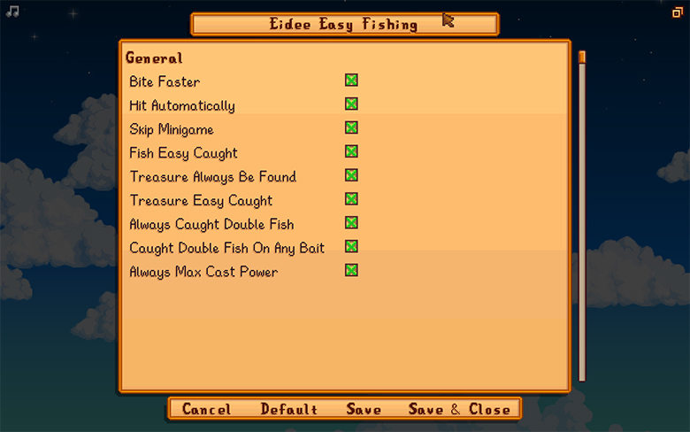

# Eidee Easy Fishing
Customizable Mod for easy fishing.

## Outline:
This Mod was created to make fishing easier. You can customize from your configuration, such as skipping minigame, minigame make easier, always found a Treasure, always double fishing.

## Config:
During the game, you can reload the configuration by pressing the F5 key, and turn the entire mod on or off by pressing the F6 key. It is possible to change the keys from the config.
Starting with version 1.1.1, you can now edit the configuration in the "[Generic Mod Config Menu](https://www.nexusmods.com/stardewvalley/mods/5098)"

| Property                         | Description                                                                                                                     |
| ------------------------------   | ---------------------------------------------------------------------------------------------------------------------           |
| Bite Faster                      | Waiting for fish to bite the bait is no longer necessary.                                                                       |
| Hit Automatically                | Clicking the mouse to start the minigame is not required. If "Skip Minigame" is enabled, the fish will be caught automatically. |
| Treasure Always Be Found         | Discovering treasure is guaranteed on every attempt, even with "Skip Minigame" enabled.                                         |
| Always Golden Treasure           | Whenever treasure appears, whether naturally or forced, it will always be a golden treasure chest.                              |
| Always Caught Double Fish        | Using Wild Bait always results in catching two fish.                                                                            |
| Caught Double Fish On Any Bait   | The chance to catch two fish is present with any bait used, and can be combined with "Always Caught Double Fish".               |
| Fish Appear Regardless of Season | Lets you catch fish that would normally be unavailable due to season or location, just like Magic Bait.                         |
| Higher Chance for Rare Fish      | Makes harder-to-find fish more likely to bite, just like a Curiosity Lure.                                                      |
| Always Max Cast Power            | Casting power is always at its maximum.                                                                                         |
| Cast At Fishing Bubbles          | Steers your cast onto the bubble spot when a normal cast could have reached it. Disabled by default.                             |
| Widen Bubble Cast Assist         | Widens that steering to any bubble in the quarter you face. Requires *Cast At Fishing Bubbles*. Disabled by default.             |
| Show Fishing Bubble Marker       | Draws a frame on the bubble spot showing whether a cast would be steered onto it. Disabled by default.                           |
| Auto Recast                      | Repeats the first manual cast and advances each catch display. Cancel with the menu, or movement after the first landing. Disabled by default. |
| Stop Auto Recast At Time         | Sets the safe-stop time for Auto Recast. Disabled by default.                                                                   |
| Auto Collect Fishing Treasure    | Moves fishing treasure and catch-menu items into your inventory automatically. Disabled by default.                             |
| Show Catch Result                | Shows the fish name, final quality and perfect status after a successful fishing minigame.                                     |
| Show Fish Chances                | Shows estimated catch chances after the bobber lands. Samples and panel opacity are configurable.                              |
| Predict Island Golden Walnuts   | Includes Ginger Island golden walnut outcomes in the chance panel. Disabled by default.                                        |
| Skip Minigame                    | The minigame is skipped, and fish are caught automatically, always achieving a perfect catch.                                   |
| Fish Easy Caught                 | In the minigame, the fish icon automatically chases the bar.                                                                    |
| Treasure Easy Caught             | In the minigame, the treasure icon automatically chases the bar.                                                                |
| Always Reveal Fish Type          | Shows which fish you are catching during the minigame, even without a Sonar Bobber equipped.                                    |
| Always Max Fish Quality          | Forces every caught fish to Iridium quality, ignoring Quality Bobber count, rod tier, and perfect-catch requirements.           |
| Always Max Fish Size             | Forces every caught fish to its maximum recorded length, ignoring rod tier and the per-frame size penalty during the minigame.  |
| Fish Movement Speed Multiplier   | This is a multiplier for the fish's movement speed in the minigame.                                                             |
| Progress Bar Decrease Multiplier | This modifies how quickly the capture progress bar decreases in the minigame.                                                   |
| Progress Bar Increase Multiplier | This modifies how quickly the capture progress bar increases in the minigame.                                                   |
| Treasure Catch Speed Multiplier  | This is a multiplier for the speed at which treasure is caught in the minigame.                                                 |
| Reload Config                    | This sets the key for reloading the configuration.                                                                              |
| Toggle Mod                       | This sets the key for turning the entire mod on or off at runtime, without opening the config menu.                             |
| Stop Auto Recast                 | Sets the key for stopping Auto Recast. Available only in config.json and disabled (`None`) by default.                          |

## Stardew Valley 1.6 Notes:
Easy Fishing now covers the catch-side mechanics introduced in 1.6:

- **Challenge Bait** — Skip Minigame catches the remaining `challengeBaitFishes` count instead of a single fish, matching how the bait counts down on escapes.
- **Deluxe Bait** — The +12 px bar growth applied by the constructor is read back at catch time, so the mod's bar-position math stays correct.
- **Sonar Bobber** — The fish identity panel is honored as-equipped; *Always Reveal Fish Type* injects it without consuming a tackle slot.
- **Mastery (Fishing) golden treasure** — Post-added treasure (from *Treasure Always Be Found*) inherits the Mastery(1) golden roll (`< 0.25 + AverageDailyLuck`) so vanilla rolls are not changed.
- **Statue of Blessings (Blessing of Waters)** — Compatible: the mod's progress-bar multipliers stack on top of the game's reduced penalty modifier without replacing it.
- **Fish Frenzy** — Bite Faster zeros the bite timer, which already short-circuits the frenzy-time halving; the mod does not target frenzy spawns.
- **Beginner's Rod** — Skip Minigame inherits the rod's quality/size floors unless *Always Max Fish Quality* / *Always Max Fish Size* are enabled, in which case the override wins.
- **Tutorial first cast** — The 0.1 starting `distanceFromCatching` for the first-ever fish is preserved instead of being stomped to 0.3.

*Fish Appear Regardless of Season* and *Higher Chance for Rare Fish* are the only options that change **which** fish is selected. They work by inserting a synthetic Magic Bait / Curiosity Lure into the rod's bait or tackle slot during the bite-wait window, and restoring the original as soon as the BobberBar opens (or the cast ends), before any bait/tackle consumption runs. *Fish Appear Regardless of Season* inserts the synthetic Magic Bait even when the bait slot is empty, so it applies whether or not you have bait equipped. The original bait stack and tackle durability are never decremented by the substitute, and the synthetic item is also restored before save and day-end so it cannot leak into a save file. Challenge Bait's catch counter and Deluxe Bait's larger bar height are replayed onto the BobberBar after restore so those bait effects are preserved alongside the Magic Bait selection. Specific Bait targeting is suppressed for casts where *Fish Appear Regardless of Season* is in effect. When *Higher Chance for Rare Fish* runs on a rod whose tackle slots are all occupied, the synthetic temporarily replaces the first tackle slot for one cast — that slot's BobberBar-construction-time effect (e.g. Cork Bobber's bar growth, and similar tackle effects) is suppressed for that single cast, while the tackle item itself and its durability are still restored before any consumption. *Fish Appear Regardless of Season* also suppresses Wild / Challenge / Deluxe Bait's faster bite-time multiplier on missed-bite re-rolls within the same cast (the first-bite timer is computed before the swap and uses the original bait correctly); enable *Bite Faster* if you want the bite-wait window to stay short regardless.

*Cast At Fishing Bubbles* moves the bobber onto the location's bubble spot, aiming at the middle of that tile so the cast picks up all three of the game's bubble effects at once: the faster bite, the deeper-water fish roll, and a fish frenzy's guaranteed species. It gives you nothing beyond those — fish size, fish quality, and treasure chance are untouched. By default it only steers casts a player could have made by hand: the bubble must be far enough ahead to be a legal cast distance, no further than this cast's own reach, and no further to the side than you could have drifted the bobber during its flight. *Widen Bubble Cast Assist* relaxes only the sideways limit, to the whole quarter you are facing; it never makes a cast travel further. A bubble that is off screen, behind you, out of range, or on a tile the game will not let you fish is left alone with no message and no wasted cast — so when the assist declines, nothing appears to happen at all. Turn on *Show Fishing Bubble Marker* to see where the boundary actually is.

While a cast is being steered, moving no longer nudges the bobber: the mod holds it on the bubble for the whole flight. Casts started by *Auto Recast* repeat the initial landing spot instead of retargeting a new bubble.

*Show Fishing Bubble Marker* works on its own and never changes where a cast lands. It draws a grey dashed frame on a bubble a cast would not be steered onto, and a pulsing green frame on one it would. While you are charging, the frame follows your current power and can switch as the bar fills; otherwise it shows what a fully charged cast would reach. During an *Auto Recast* loop it keeps showing what a manual cast could reach; the loop repeats the initial landing spot.

*Auto Recast* records the released power, direction, and actual landing point of the first manual cast, including sideways steering or bubble assist. Each recast repeats that spot; it does not follow bubbles that appear or move later. The *Always Max Cast Power* option still applies to the initial manual cast. After each catch, the mod advances the fish hold-up automatically so the loop can continue. During the initial bobber flight, movement controls can steer the cast; afterwards movement cancels the loop. The menu key, controller Start or B, and the optional stop key can cancel it throughout.

Auto Recast also works during the Stardew Valley Fair fishing game and the Festival of Ice fishing contest, and ends with the contest. The optional stop time and stamina protection are suspended during these contests so they don't interrupt the event.

Before each recast the mod checks that the player is still standing in the original position and the recorded landing tile remains fishable. Otherwise the loop stops. It also stops itself before a cast would drop stamina to zero; it never eats food or restores stamina for you. Casts that cost no stamina, from an Efficient rod or while Statue of Blessings (Blessing of Waters) is active, do not trigger that stop. Both the stamina stop and the optional stop time open the game menu, but this freezes the clock only in single-player. In multiplayer, the clock keeps running while the menu is open. Disable automatic recasting in other fishing mods to avoid competing control of the rod.

*Show Fish Chances* samples the game’s fish selection over several updates after the bobber lands. The percentages are estimates. Every sampled catch is shown individually, with legendary fish labeled and sorted first. When the list is long, hover over the panel and use the mouse wheel to scroll. A very rare fish may not appear at all if it is not observed in the configured sample count. The panel refreshes when the time, bobber position, equipment, or other tracked conditions change. It uses a separate random generator, and respects the active bait, tackle, bubble and fish-selection options. On Ginger Island it excludes golden walnuts by default, so percentages describe other catches conditional on not receiving a walnut; the special walnut-only pool reports no other catch. Enable *Predict Island Golden Walnuts* to preview single-player walnuts and, when hosting multiplayer, an expected extra walnut drop without issuing a drop request. The host preview can change if another player collects a shared walnut first. Farmhands see an unavailable message for multiplayer walnut events. This setting never changes the actual catch. Fish ponds show their current fish type and population by reading pond state, without removing fish; empty ponds show a message. Farm maps that redirect fish selection and unrecognized special location logic show an unavailable message; the panel is hidden during festivals. Custom fish selection or item-query mods can change the results or have their own side effects when queried. If another mod also shows fish chances, disable one of the panels to avoid overlap.

*Auto Collect Fishing Treasure* is independent of *Auto Recast*. It transfers items from fishing treasure and catch menus into your inventory and closes the menu only when every item fits on that attempt. If an item fits only partially or not at all, its remainder stays in the menu, and the mod then leaves that menu entirely to you until you close it yourself — it will not take over again even if you free up space, and it never acts while you are holding an item on the cursor. While such a menu is open, *Auto Recast* also waits rather than starting the next cast.

**Multiplayer**: the two selection-altering options (*Fish Appear Regardless of Season*, *Higher Chance for Rare Fish*) are silently disabled in multiplayer sessions. The fishing rod's attachment slots are network-synced, so swapping in a synthetic on a farmhand could be persisted by the host's save (e.g. on disconnect). All other options work normally in multiplayer.

The progress bar multipliers affect the amount the bar changes from frame to frame. They do not replace the game's own bait, lure, or penalty rules.

## Contacts:
[Open an issue](https://github.com/eideehi/sdv-easyfishing/issues) for bug reports, questions, suggestions, and requests.

## Credits:
* Dependencies:
  * [Generic Mod Config Menu](https://www.nexusmods.com/stardewvalley/mods/5098)

# License:
Eidee Easy Fishing is developed and released under the [MIT license](./LICENSE), except for the APIs of the libraries it depends on.
